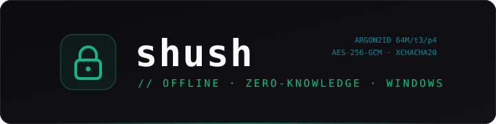
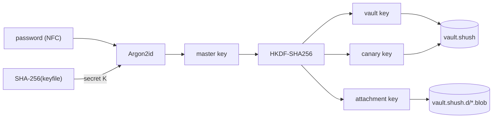

<div align="center">



### Offline-first, zero-knowledge password manager & 2FA authenticator for Windows.

**Tauri v2 · Rust · Svelte 5 · Tailwind v4**<br>
One encrypted file on your disk. No account, no cloud, no telemetry.

<br>

<a href="https://kash-talel.github.io/shush/"></a>&nbsp;
<a href="https://github.com/kash-talel/shush/releases"></a>&nbsp;
<a href="https://github.com/kash-talel/shush/blob/main/docs/README.md"></a>

<br>

[](https://github.com/kash-talel/shush/actions/workflows/ci.yml)


[](LICENSE)

[Quick start](#quick-start) •
[Why shush?](#why-shush) •
[Security model](#security-model) •
[Architecture](#architecture) •
[Roadmap](#roadmap)

</div>

---

> [!IMPORTANT]
> **The zero-knowledge, offline-first pledge.**
> - **No servers, no account.** shush makes no network connections: the UI may only talk to its own
>   Rust core (enforced by the Content-Security-Policy). Your vault is one file you own.
> - **The master key is never stored.** It is re-derived with Argon2id from your password (and
>   optional keyfile) at every unlock; only the salt and KDF parameters are on disk.
> - **Everything on disk is authenticated encryption.** Changing any single byte of the vault, a
>   backup or an attachment is detected and refused.
> - **Lock means wipe.** Locking (manually, on Win+L, sleep, lid close or idle) drops the derived
>   keys and decrypted data from the Rust core's memory and clears any password shush put on the
>   clipboard. Known limits are documented, not hidden: see [Security model](#security-model).

---

## Why shush?

Password managers make you pick between convenience and control:

| Option | What's good | What's missing |
|---|---|---|
| **1Password** | Polished apps on every platform, strong sharing | Account + cloud required, subscription, closed source |
| **Bitwarden** | Open source, free tier, self-hostable | Cloud-first: your vault lives on their server or one you operate |
| **KeePassXC** | Mature, offline, open source | Dated Qt UI, sync is "put the file in a synced folder", auto-type matches **window titles**, which any web page can spoof |
| **shush** | Native Windows UX (Tauri v2 / Svelte 5), single local file, zero network, encrypted sidecar attachments, hardened Win32 integration | Alpha. On-demand PAKE LAN sync and origin-bound auto-type are **planned** ([Roadmap](#roadmap)) |

shush is for people who want KeePass-style ownership with a keyboard-first, modern desktop app, and
who would rather see every security trade-off written down than marketed away.

## Quick start

**Easiest (prebuilt):** download `shush-<version>-setup.exe` from the
[Releases](https://github.com/kash-talel/shush/releases) page and run it. It installs per-user
(no admin) and adds a Start menu entry. The installer is unsigned (SmartScreen: "More info", then
"Run anyway").

> [!NOTE]
> **No release has been published yet.** Until `v0.1.0` is tagged, build from source (below).

**Or build from source:**

**You need:** Windows 10/11, [Rust stable](https://rustup.rs), [Node.js 22+](https://nodejs.org), and
the WebView2 runtime (preinstalled on Windows 11 and current Windows 10).

```powershell
# 1. Clone
git clone https://github.com/kash-talel/shush
cd shush

# 2. Frontend dependencies (Svelte 5 + Vite live in src/)
npm ci --prefix src

# 3. Run the test suite (crypto, vault format, items, backup, CSV, attachments)
cd src-tauri
cargo test --lib
cd ..

# 4. Run the app in development mode
npx --prefix src tauri dev

# 5. Or build a standalone shush.exe (src-tauri\target\release\shush.exe)
npx --prefix src tauri build --no-bundle
```

On first start shush offers to create a vault (master password, optional keyfile, cipher choice),
then a one-time screen helps you import passwords from your browser's CSV export. From then on:

| Key | Action |
|---|---|
| `Ctrl+Alt+Space` | Quick search from any app: `Enter` copies the password, `Ctrl+Enter` the username, `Alt+Enter` the 2FA code |
| `Ctrl+N` / `Ctrl+F` / `Ctrl+L` | New login / search / lock |
| Close button | Hides to the tray; the vault keeps auto-locking |

> [!TIP]
> Built with the GNU Rust toolchain? Copy `WebView2Loader.dll` from `src-tauri\target\release\`
> next to `shush.exe` when you move it. MSVC builds link it statically.

## Security model

The full threat analysis is in [`docs/spec/security-model.md`](docs/spec/security-model.md) and
the byte-level format in [`docs/FORMAT.md`](docs/FORMAT.md). In short:

| Layer | Guarantee |
|---|---|
| **KDF** | Argon2id v1.3 (RFC 9106), 64 MiB / 3 passes / 4 lanes by default, per-vault 32-byte salt. Memory-hard, so GPU/ASIC guessing is expensive. Parameters are bounds-checked *before* hashing, so a tampered header cannot exhaust memory. |
| **Credentials** | Password is Unicode-NFC-normalized; the optional keyfile's SHA-256 is Argon2id's dedicated secret input (no ambiguous concatenation). |
| **Encryption** | AEAD envelopes: AES-256-GCM (default) or XChaCha20-Poly1305. HKDF-SHA256 splits the master key into vault, canary and attachment keys. Fresh random nonces on every write. |
| **Integrity** | Every header byte is authenticated; a 33-byte canary tells "wrong password" apart from "tampered file". Payloads are padded (PADMÉ) so file size barely leaks item count. |
| **Storage** | Crash-safe writes: temp file → fsync → read back **and decrypt** → keep `.bak` → atomic rename. Attachments are separately sealed sidecar blobs bound to their vault and id. |
| **Desktop** | Clipboard copies are excluded from Win+V history and Cloud Clipboard, and auto-cleared only if still ours. Auto-lock on Win+L, sign-out, RDP disconnect, sleep, lid close (display-off) and idle. Windows are excluded from screen capture. Single instance, so two processes never write one vault. |
| **Auto-type** *(planned, 7b)* | Only into sites whose origin the browser extension verified. Window titles never trigger typing; Quick search uses them only to pre-select a result. |
| **LAN sync** *(planned, 8)* | On-demand, time-boxed pairing with a PAKE one-time code: no always-on mDNS broadcast, no interceptable PIN. |
| **Duress vault** *(planned, 8)* | Fixed-size padded slots and constant-work unlock, so a decoy is indistinguishable. |

**Known limits** (tracked as issues, not swept under the rug):
- The UI runs in WebView2: a password you *reveal* or *type* exists as a JavaScript string that
  cannot be wiped (#6). shush never sends the whole vault to the UI, and copying happens in Rust.
- Hibernation and the pagefile may hold memory pages from an unlocked session (#6).
- Binaries are not code-signed yet.

Every crypto primitive is pinned by **known-answer tests computed independently** (Node.js
`crypto`, hash-wasm's reference Argon2, `@noble/ciphers`), plus exhaustive single-bit tamper tests.

## Architecture



| Path | What lives there |
|---|---|
| `src-tauri/src/crypto/` | Argon2id KDF, keyfiles, AEAD envelope + canary, HKDF key schedule, CSPRNG password generator, zeroizing key types |
| `src-tauri/src/vault/` | Binary container + crash-safe writer, data model, item & folder CRUD, sidecar attachment storage, `.shushbackup` export/import, CSV migration, lock state machine |
| `src-tauri/src/os/` | Win32 integration: history-excluded clipboard, session/power/idle auto-lock, browser detection, active-window context |
| `src-tauri/src/totp/` | RFC 6238 TOTP (Base32 or `otpauth://`) |
| `src-tauri/src/lib.rs` | Tauri commands: the only bridge between UI and core; returns redacted views, never the vault |
| `src/` | Svelte 5 frontend: create/unlock, dashboard (folders, search, item view, generator, TOTP ring), backup & import, Quick search window |
| `docs/` | [Specs](docs/spec/), [file format](docs/FORMAT.md), [roadmap](docs/ROADMAP.md), [end-to-end test harness](docs/testing/) |
| `.claude/skills/` | Vendored agent skills (Svelte best practices, native-feel desktop) used to build shush |

Design notes:
- **Rust owns every secret.** The UI gets list rows and item details without passwords or TOTP
  secrets; copy and TOTP run in Rust. Editing never loads the current password into the UI.
- **Transactional saves.** Every change is applied to a copy, saved crash-safely, then committed;
  a failed save rolls memory back.
- **Two windows, one bundle.** The Quick search window is prewarmed hidden at startup, so the
  hotkey never waits on WebView2.

## Roadmap

<details open>
<summary><b>What's new</b></summary>

- **Phase 4c: encrypted attachments.** Files up to 10 MB as sealed sidecar blobs, included in backups. (#39)
- **Phase 5b: Quick search** on `Ctrl+Alt+Space` with window-context pre-selection. (#38)
- **Phase 4b: folders.** Create, rename, delete (items are kept), sidebar filter. (#37)
- **Phase 7a: first-run screen.** Detects installed browsers and guides a CSV import. (#36)
- **Phase 6b: CSV migration** from Chrome, Edge, Brave, Firefox, Bitwarden, 1Password, KeePass, KeePassXC. (#35)
- **Phase 6a: encrypted backups** (`.shushbackup`) with preview, merge and clean restore. (#34)
- **Phase 5a: desktop integration.** Auto-lock, tray, single instance, screen-capture protection. (#32)
- **Phase 1: crypto engine** with independently computed known-answer tests. (#28)

</details>

- [x] Crypto engine: Argon2id, keyfiles, AES-256-GCM / XChaCha20-Poly1305 (Phases 1–2)
- [x] Vault format, crash-safe writer, create / unlock / lock (Phase 3)
- [x] Dashboard: items, TOTP, generator, safe clipboard (Phase 4), folders (4b), attachments (4c)
- [x] Auto-lock, tray, single instance, capture protection (5a), Quick search (5b)
- [x] Encrypted backups (6a), CSV migration (6b), first-run import screen (7a)
- [ ] Browser extension + native messaging with one-time-code pairing, origin-bound auto-type (7b)
- [ ] Deniable duress vault, on-demand PAKE LAN sync, air-gapped mode (8)
- [ ] Signed installer and `v0.1.0` release

The live tracker, including every owner decision, is [`docs/ROADMAP.md`](docs/ROADMAP.md).

## Contributing & security

- Read [`docs/README.md`](docs/README.md) for how the docs, specs and test harness fit together.
- Every change must pass `cargo fmt --check`, `cargo clippy --all-targets -- -D warnings`,
  `cargo test --lib`, `npm run --prefix src check` and the frontend build. CI runs all of them.
- Found a vulnerability? Please report it privately, see [`SECURITY.md`](SECURITY.md).

## License

[MIT](LICENSE)
