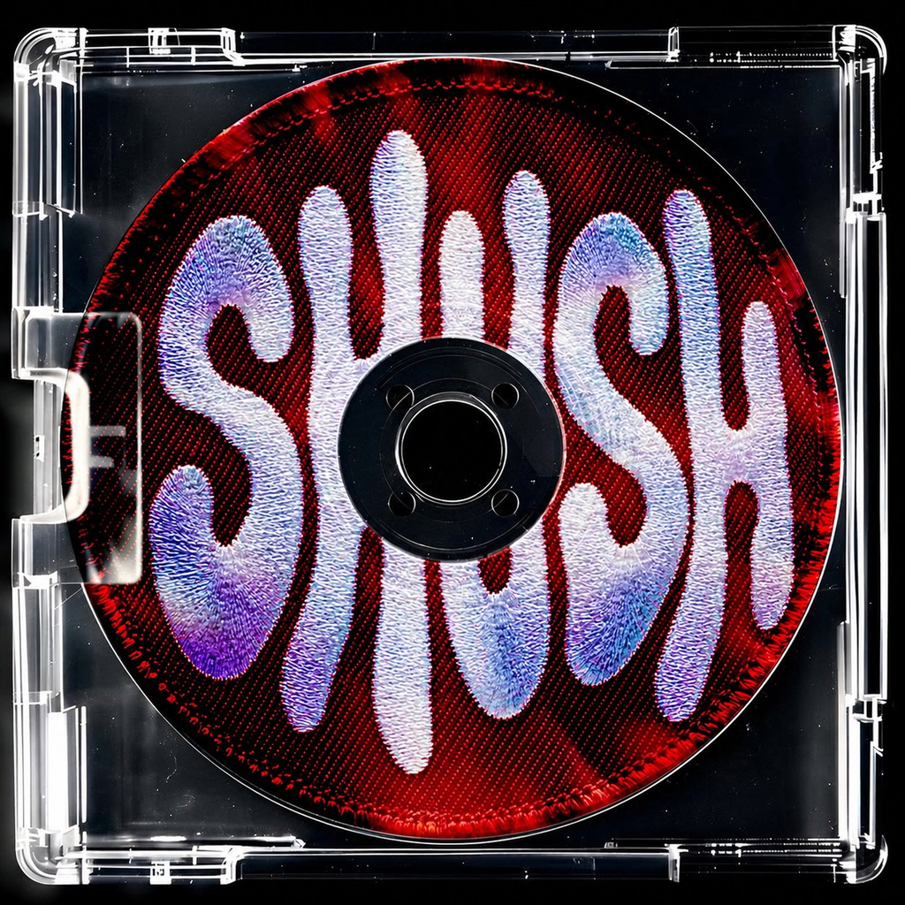

<p align="center">
  <a href="https://kash-talel.github.io/shush/"></a>
</p>

<h1 align="center">shush</h1>

<p align="center">
  Offline password manager and 2FA authenticator for Windows.<br>
  One encrypted file on your disk. No account, no cloud, no telemetry.
</p>

<p align="center">
  <a href="https://github.com/kash-talel/shush/actions/workflows/ci.yml"></a>
  
  <a href="LICENSE"></a>
</p>

<p align="center">
  <a href="https://kash-talel.github.io/shush/">Website</a> ·
  <a href="docs/README.md">Docs</a> ·
  <a href="docs/spec/security-model.md">Security model</a> ·
  <a href="docs/FORMAT.md">File format</a> ·
  <a href="docs/ROADMAP.md">Roadmap</a>
</p>

---

shush keeps logins, secure notes, 2FA secrets and file attachments in a single vault file that
only your master password (and optional keyfile) can open. It is built with Tauri v2: a Rust core
holds every secret, and a Svelte 5 window shows only what you ask to see.

> [!WARNING]
> Alpha. The vault format is stable and tested, but there is no signed release yet and the browser
> extension is not built. Keep an encrypted backup.

## Install

Download `shush_x64-setup.exe` from the [latest release](https://github.com/kash-talel/shush/releases/latest)
and run it. It installs for your user only (no admin), offers a desktop shortcut, and can start
shush when it finishes. The installer is not code-signed yet: if SmartScreen warns, choose
**More info → Run anyway** after checking the file against `SHA256SUMS.txt` in the release
(`Get-FileHash .\shush_x64-setup.exe`). The `.msi` is for managed deployment.

Your vault lives in `%APPDATA%\com.shush.vault` and survives uninstalling. The uninstaller's
*Delete the application data* box erases it only after a second confirmation.

Already running a `shush.exe` you built or copied by hand? Quit it, run the installer, then delete
the old copy and any shortcut to it. The installed app reads the same vault, so nothing moves.
The `.exe` installs per user in `%LOCALAPPDATA%\shush`. The `.msi` installs per machine in
Program Files and asks for admin. Use one or the other, not both.

Releases are cut by merging the release PR that release-please keeps open and approving the
`release` deployment; no tag is pushed by hand. See [docs/RELEASING.md](docs/RELEASING.md).

## Build from source

Windows 10/11, [Rust stable](https://rustup.rs) (1.80+), [Node.js 22](https://nodejs.org), WebView2
(preinstalled on Windows 11).

```powershell
git clone https://github.com/kash-talel/shush; cd shush
npm ci --prefix src
npx --prefix src tauri dev
```

First launch creates a vault, then offers to import a CSV export from your browser or old password
manager. To build a standalone binary instead:

```powershell
npx --prefix src tauri build --no-bundle      # src-tauri\target\release\shush.exe
```

> [!TIP]
> GNU toolchain builds need `WebView2Loader.dll` (in `src-tauri\target\release\`) next to
> `shush.exe`. MSVC builds link it statically.

## Keys

| Shortcut | Where | Does |
|---|---|---|
| `Ctrl+Alt+Space` | anywhere in Windows | Open Quick search |
| `Enter` | Quick search | Copy password, close |
| `Ctrl+Enter` | Quick search | Copy username |
| `Alt+Enter` | Quick search | Copy the current 2FA code |
| `Esc` | Quick search | Close |
| `Ctrl+N` | main window | New login |
| `Ctrl+F` | main window | Search the vault |
| `Ctrl+L` | main window | Lock and wipe keys |

Closing the main window hides it to the tray; auto-lock keeps running.

## Cryptography

```
password ──NFC──┐
                ├─► Argon2id v1.3 ─► master key ─► HKDF-SHA256 ─┬─► vault key ──────► vault.shush
keyfile ─SHA-256┘   64 MiB · t=3 · p=4                          ├─► canary key ─────► 33-byte canary
                    32-byte salt per vault                       └─► attachment key ─► vault.shush.d/*.blob
```

| Stage | Construction |
|---|---|
| Key derivation | Argon2id v1.3 (RFC 9106), 64 MiB, 3 passes, 4 lanes, 32-byte salt. Header parameters are bounds-checked before hashing, so a tampered file cannot demand unbounded memory. |
| Second factor | Optional keyfile: its SHA-256 is Argon2id's secret input `K`, not concatenated to the password. |
| Encryption | AEAD: AES-256-GCM (default) or XChaCha20-Poly1305, chosen per vault. Fresh random nonce on every write. |
| Authentication | The whole header is associated data. The canary separates "wrong password" from "file was modified". |
| Size hiding | Payloads are PADMÉ-padded. |
| Writes | Temp file → fsync → read back and decrypt → keep `.bak` → atomic rename. |
| Memory | Key material lives in `zeroize` types and is wiped on lock. |

Primitives are pinned by known-answer vectors computed outside Rust (Node `crypto`, hash-wasm
Argon2, `@noble/ciphers`) and by single-bit tamper tests.

## Threat model

**Defended**

- Offline guessing against a stolen vault file or backup: memory-hard KDF, optional keyfile.
- Tampering with the vault, a backup or an attachment: every byte is authenticated; a modified file
  is refused, never partially loaded.
- A malicious page in the UI: the CSP allows connections only to the Rust core; the UI never
  receives the vault or a TOTP secret, and receives a password only when you reveal it.
- Spoofed window titles: they can pre-select a Quick search result but never trigger typing.
  Auto-type will only target origins verified by the browser extension (phase 7b).

**Not defended**

- Malware running as your user while the vault is unlocked.
- Revealed or typed passwords live as JavaScript strings in WebView2 and cannot be wiped ([#6](https://github.com/kash-talel/shush/issues/6)).
- Hibernation files and the pagefile may hold pages from an unlocked session ([#6](https://github.com/kash-talel/shush/issues/6)).
- Binaries are not code-signed yet.

## Windows hardening

| Event | shush |
|---|---|
| Win+L, sign-out, RDP disconnect | Locks and wipes keys |
| Sleep, display off (lid close) | Locks |
| Idle (15 min default) | Locks |
| Copy a secret | Excluded from Win+V history and Cloud Clipboard; cleared after 30 s if the clipboard still holds it |
| Screen capture | Windows are excluded from screenshots and recordings |
| Second launch | Focuses the running instance; one process owns the vault |

## Layout

| Path | Contents |
|---|---|
| `src-tauri/src/crypto/` | KDF, keyfiles, AEAD envelope and canary, HKDF schedule, password generator |
| `src-tauri/src/vault/` | Container format, crash-safe writer, items, folders, attachments, backups, CSV import |
| `src-tauri/src/os/` | Clipboard, session/power/idle auto-lock, browser detection, active-window context |
| `src-tauri/src/totp/` | RFC 6238 TOTP, Base32 and `otpauth://` |
| `src-tauri/src/lib.rs` | Tauri commands: the only bridge between UI and core |
| `src/` | Svelte 5 + Tailwind v4 UI: main window and Quick search window |
| `docs/` | Specs, file format, roadmap, end-to-end test harness |
| `site/` | Landing page (GitHub Pages) |

## Status

Phases 1–7a are merged: crypto engine, vault container, dashboard with TOTP and generator, folders,
attachments, auto-lock and tray, Quick search, encrypted backups, CSV import, first-run onboarding.

Next: **7b**, a native messaging host and browser extension paired with a one-time code, then
extension-verified auto-type. After that, **8**: deniable duress vault, on-demand PAKE LAN sync and
air-gapped mode. Plan and acceptance criteria: [`docs/ROADMAP.md`](docs/ROADMAP.md).

## Contributing

CI requires `cargo fmt --check`, `cargo clippy --all-targets -- -D warnings`, `cargo test --lib`,
`npm run --prefix src check` and the frontend build. UI changes are verified end to end over the
Chrome DevTools Protocol: see [`docs/testing/`](docs/testing/README.md).

Report vulnerabilities privately: [`SECURITY.md`](SECURITY.md).

## License

[MIT](LICENSE)
