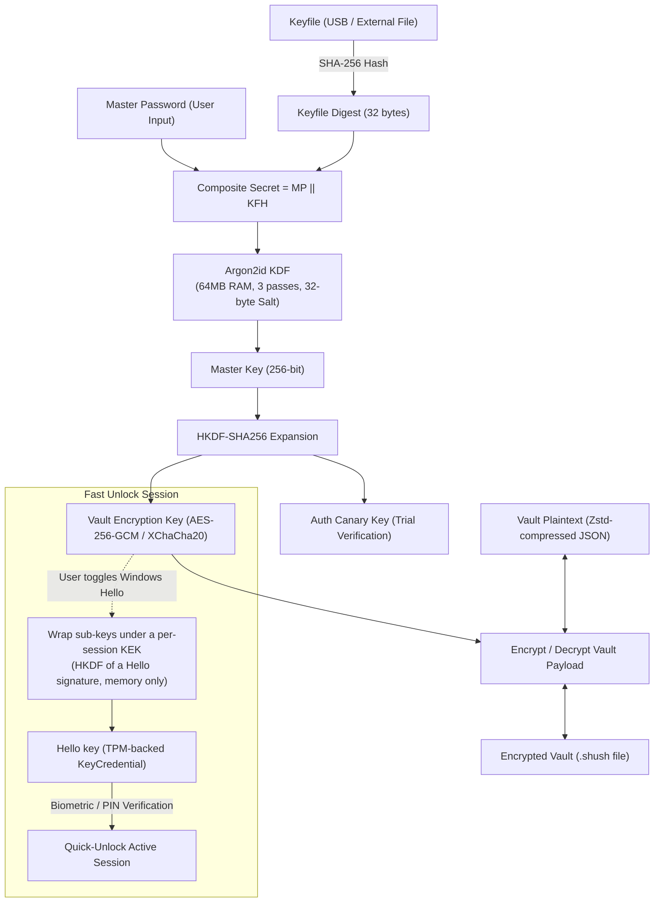
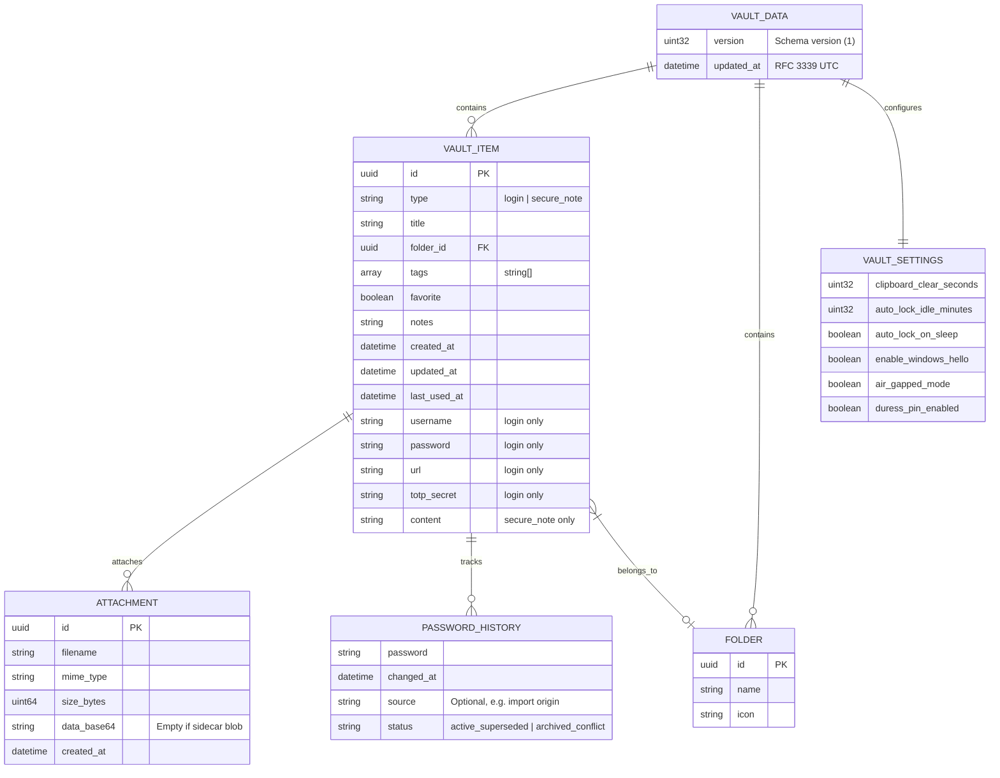
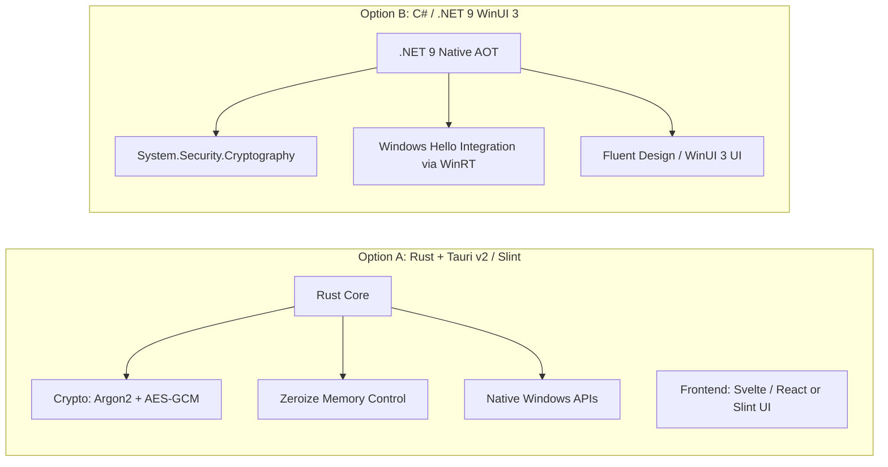

# Project "shush" — Architecture & Implementation Plan

"**shush**" is designed as a secure, lightweight, and offline-first Windows password manager distributed as a standalone `.exe`. Its primary goals are **zero-knowledge security**, **bulletproof memory hygiene**, and **frictionless desktop user experience**.

---

## 1. High-Level Security Architecture

"shush" operates under a **Three-Pillar Security Model**:
1. **Something You Know**: Master Password.
2. **Something You Have**: Physical Keyfile (stored on an external USB drive or independent directory).
3. **Biometric / Hardware Convenience**: Windows Hello (TPM 2.0) for instant daytime unlocks.



### 1.1 Cryptographic Standards

| Component | Standard / Algorithm | Rationale |
| :--- | :--- | :--- |
| **Key Derivation Function (KDF)** | **Argon2id** (RFC 9106) | Highly resistant to GPU/FPGA/ASIC brute-force attacks by being memory-hard. Standard config: `t=3` (iterations), `m=65536` (64 MB), `p=4` (threads). |
| **Symmetric Cipher** | **AES-256-GCM** or **XChaCha20-Poly1305** | Authenticated Encryption with Associated Data (AEAD). Provides both confidentiality and tamper detection (integrity/authenticity). |
| **Key Expansion** | **HKDF-SHA256** | Derives sub-keys (encryption key, authentication canary key) safely without reusing the raw master key. |
| **Local Fast-Unlock** | **Windows Hello** (`KeyCredentialManager`) | Wraps the vault sub-keys in memory under a key derived from a Hello signature; never DPAPI, never on disk, at most 8 h. See [`windows-hello.md`](windows-hello.md). |

---

## 2. Vault File Format & Storage Strategy

Instead of keeping sensitive fields individually encrypted inside a plaintext database (which leaks metadata such as URLs, email addresses, and timestamps), `shush` should use **Full-Envelope Vault Encryption**.

### 2.1 The Binary Vault Container (`vault.shush`)

```
+-------------------------------------------------------------+
| Header (Unencrypted Metadata)                               |
|   - Magic Bytes: "SHUSH" (5 bytes)                          |
|   - Format Version: uint16 (e.g. 0x0001)                    |
|   - Argon2id Salt: 32 bytes (Random CSPRNG)                 |
|   - Argon2id Parameters: memory (uint32), iter (uint32)     |
|   - Cipher Nonce / IV: 12 or 24 bytes                       |
+-------------------------------------------------------------+
| Canary Block (AEAD Encrypted Known Token)                   |
|   - Quick check if password is correct without loading DB   |
+-------------------------------------------------------------+
| Encrypted Payload (AEAD Ciphertext)                         |
|   - Compressed (zstandard) JSON model (VaultData)           |
|   - Auth Tag (16 bytes)                                     |
+-------------------------------------------------------------+
```

> [!NOTE]
> The container format above illustrates the envelope concept. The normative on-disk format is defined in [`FORMAT.md`](../FORMAT.md) (format version 3 with dual fixed-size slots for plausible deniability; version 2 for `.shushbackup` single payloads).

### 2.2 Data Schema

When decrypted into memory, the payload deserializes into an in-memory document tree (`VaultData`, defined normatively in [`master-specification.md`](master-specification.md#5-in-memory-data-models--schema) and implemented in `src-tauri/src/vault/models.rs`).



> [!NOTE]
> Early architectural ideation contemplated SQLite storage and conceptual item types (`card`, `identity`, `CUSTOM_FIELD`). The production design standardized on a zero-dependency, authenticated Zstandard-compressed JSON payload (`VaultData`) supporting `login` and `secure_note` items with embedded `password_history` arrays (`{password, changed_at, source, status}`). Additional item types may be evaluated in future format versions.

---

## 3. Memory Hygiene & Operational Security

Protecting passwords on disk is only half the battle; managing them safely while the executable is running is critical:

1. **Zeroing Sensitive Memory**:
   - Master passwords, derived keys, and decrypted credentials must reside in allocated memory that is explicitly wiped (`SecureZeroMemory` on Windows / `zeroize` crate in Rust) when freed.
   - Standard strings must not be allowed to linger in garbage-collected heaps.
2. **Clipboard Auto-Clear**:
   - When the user clicks "Copy Password", copy to the Windows clipboard and start a **30-second countdown**.
   - Before wiping, verify the clipboard sequence number (`GetClipboardSequenceNumber`) to ensure the user hasn't copied something else in the meantime.
3. **Screen Capture & Keylogger Defense**:
   - Set `SetWindowDisplayAffinity(hwnd, WDA_EXCLUDEFROMCAPTURE)` on Windows so screenshot tools and screen-sharing apps see only a blank window for sensitive views.
4. **Auto-Lock Triggers**:
   - Lock vault automatically after $N$ minutes of idle time.
   - Lock vault immediately when the workstation locks (`WM_WTSSESSION_NOTIFICATION` -> `WTS_SESSION_LOCK`) or the computer enters sleep/hibernation.

---

## 4. Recommended Tech Stack for a Windows `.exe`

For a standalone Windows `.exe` password manager, two main approaches stand out:



### Recommendation: **Rust + Tauri v2** or **Rust + Slint**

| Criteria | Rust + Tauri v2 (Recommended) | C# .NET 9 (WPF / WinUI 3) | Go + Wails |
| :--- | :--- | :--- | :--- |
| **Memory Safety & Zeroization** | **Flawless**: Rust allows deterministic destruction and manual heap zeroing via `zeroize`. | **Fair**: GC makes it harder to guarantee strings aren't duplicated across memory sweeps. | **Poor**: GC runtime makes zeroing memory unreliable. |
| **Binary Size** | ~10–15 MB single `.exe`. | ~30–50 MB (Native AOT). | ~15–20 MB. |
| **UI Aesthetics** | Modern web technologies (Svelte, Tailwind, React) inside a native WebView2 frame. | Native Windows 11 Fluent Design out-of-the-box. | Web frontend inside WebView2. |
| **Crypto Ecosystem** | `ring`, `aes-gcm`, `argon2`, `zeroize` are world-class audited crates. | Robust BCL crypto (`AesGcm`, `Rfc2898DeriveBytes`). | Standard library crypto. |

> [!TIP]
> **Rust + Tauri v2** provides the ideal balance: the sensitive cryptographic and vault logic stays in strictly typed, memory-safe Rust with instant memory clearing, while the UI can be built with modern, ultra-responsive tools like Tailwind and Svelte.
> The workspace follows a split layout: the Tauri/Rust core resides in `src-tauri/`, while the frontend project is housed in `src/` (with source files under `src/src/`). See [`master-specification.md`](master-specification.md#8-complete-project-layout) for the complete directory layout.

---

## 5. Seamless User Experience Features

To make `shush` feel effortless and enjoyable for daily use:

1. **Global Quick Search (`Ctrl + Alt + Space`)**:
   - Opens a Spotlight/Raycast-like mini search overlay.
   - Hotkey: `Ctrl + Alt + Space` (Owner decision #14: selected to prevent hotkey collisions with Windows keyboard layout switching, superseding early drafts of `Alt + Shift + S` and `Ctrl + Space`).
   - Type 2 letters of a website name (e.g., `"gi"` for GitHub), press Enter to copy the password, or `Ctrl+Enter` to copy the username.
2. **Integrated Built-in TOTP Authenticator**:
   - Generates 6-digit 2FA codes directly alongside the password, with a progress ring showing the remaining 30-second window.
3. **Smart Password Generator**:
   - Customizable character sets (letters, numbers, symbols, ambiguous character exclusion).
   - Passphrase generator using the **EFF Diceware** wordlist (e.g. `correct-horse-battery-staple`).
4. **Password Health & Breach Detector**:
   - Evaluates entropy (zxcvbn score).
   - Flags reused or weak passwords.
   - Optional, opt-in (off by default, blocked by Air-Gapped Mode) breach check via the **HaveIBeenPwned API** with `Add-Padding: true` using **$k$-Anonymity** (only the first 5 characters of the SHA-1 hash of the password are transmitted, preserving complete privacy).
5. **Windows Hello Integration**:
   - First unlock requires the full Master Password.
   - Subsequent unlocks while the app is active in the background can be authorized in milliseconds using a fingerprint or PIN, for at most 8 hours after the password unlock. Lock still wipes the keys; see [`windows-hello.md`](windows-hello.md).

---

## 6. Implementation Roadmap

> [!NOTE] Authoritative Roadmap
> The preliminary 4-phase outline below reflects early architecture scoping. The authoritative roadmap tracking all 8 phases, milestones, active progress, and owner decisions is maintained in [`docs/ROADMAP.md`](../ROADMAP.md) and [`master-specification.md` §12](master-specification.md#12-implementation-roadmap-for-claude).

### Phase 1: Cryptographic Engine & Vault Core (CLI / Backend)
- [ ] Implement `Argon2id` key derivation with composite inputs (`MasterPassword + SHA-256(Keyfile)`).
- [ ] Implement CSPRNG Keyfile generator (32-byte binary keyfile).
- [ ] Implement `AES-256-GCM` envelope encryption with Canary token verification.
- [ ] Implement the `vault.shush` binary serializer / deserializer.
- [ ] Write rigorous unit tests covering corrupt keyfiles, wrong passwords, missing USB keys, and tamper detection.
- [ ] Integrate `zeroize` for all key material, composite secrets, and decrypted buffer structs.

### Phase 2: Core Desktop UI & Vault CRUD
- [ ] Set up the Tauri v2 / Rust project structure.
- [ ] Build Master Password + Keyfile selection unlock screen (with drag-and-drop file picker).
- [ ] Build initial Vault setup wizard (Master Password creation + Keyfile export/save prompt).
- [ ] Implement credential list, detail view, creation/edit modals, and search filtering.
- [ ] Add password generator modal with entropy indicator.

### Phase 3: Seamless Desktop UX
- [ ] Windows System Tray minimization & auto-launch on Windows startup.
- [ ] Clipboard auto-wipe timer with sequence validation.
- [ ] Auto-lock when workstation locks or goes idle.
- [ ] Quick Search overlay (Spotlight style) with global hotkey (`Ctrl + Alt + Space`).

### Phase 4: Advanced Features & Hardening
- [ ] TOTP Authenticator (RFC 6238) calculation and visual timers.
- [ ] Windows Hello quick unlock per [`windows-hello.md`](windows-hello.md) (`KeyCredentialManager`, memory-only session).
- [ ] Export (Encrypted `.shushbackup` backup [magic `SHBKP`], Plaintext CSV with warning modal) and Import (Bitwarden / 1Password / Chrome CSV).
- [ ] Memory dump protection (`SetWindowDisplayAffinity`, `VirtualLock`).
