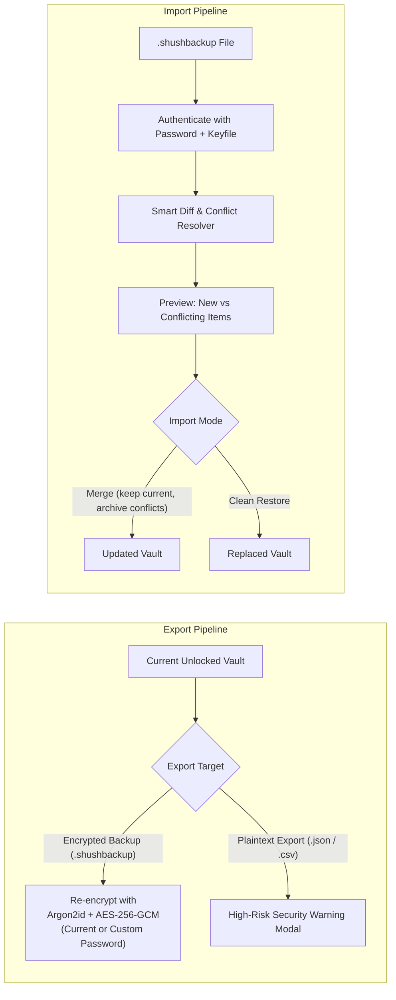
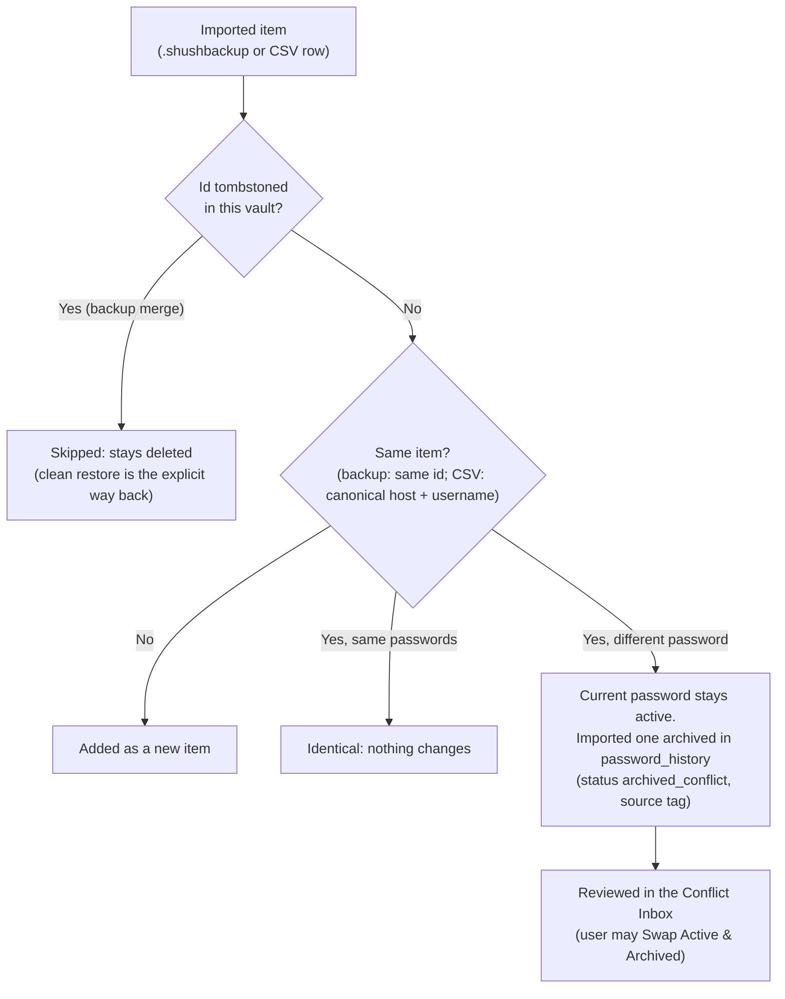
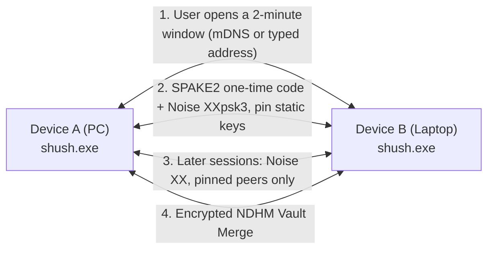

# Project "shush" — Master Engineering Specification & Implementation Blueprint

> **Notice for Implementing AI (Claude / Engineer):**  
> This document is the definitive, authoritative technical specification for building **shush**. All architectural decisions, cryptographic protocols, data schemas, and user experience flows have been finalized. Follow this blueprint strictly during implementation.

---

## 1. Executive Summary & Product Vision

- **Application Name**: `shush`
- **Target Platform**: Windows 10 / 11 (x64) standalone executable (`shush.exe`)
- **Category**: Offline-first, Zero-Knowledge Desktop Password Manager & 2FA Authenticator
- **Core Philosophy**:
  - **Zero Knowledge**: The app never stores master credentials in plaintext. If the vault file is inspected on disk, zero metadata (no URLs, usernames, or item counts) is leaked.
  - **Defense in Depth**: Three-tier composite authentication (Master Password + Optional Physical Keyfile + Windows Hello TPM biometric quick-unlock).
  - **Elite Desktop UX**: System tray persistence with a Raycast/Spotlight-style floating quick search (`Ctrl + Alt + Space`) for instant, keyboard-first credential retrieval.

---

## 2. Technology Stack ("Elite Modern Standard")

To satisfy the highest security and performance standards:

| Layer | Technology | Version / Tooling | Purpose & Rationale |
| :--- | :--- | :--- | :--- |
| **Backend & Crypto Core** | **Rust** | 2021/2024 Edition | Guaranteed memory safety, zero-cost abstractions, deterministic memory wiping via `zeroize`, and audited cryptographic crates. |
| **Desktop Shell** | **Tauri v2** | `tauri` v2.x | Native Windows WebView2 frame, global hotkeys, system tray, tiny footprint (~12 MB binary, ~30 MB idle RAM vs 180MB+ for Electron). |
| **Frontend UI** | **Svelte 5** + **Vite** | Modern Runes syntax | Ultra-reactive, zero virtual DOM overhead, instantaneous state updates. |
| **Styling & Icons** | **Tailwind CSS v4** + **Lucide** | CSS-first (`@tailwindcss/vite`, no legacy `tailwind.config.js`) | Clean, sleek, minimalist aesthetic matching Linear / Raycast. |
| **Packaging** | **Tauri Bundler** | Single-file `.exe` / WiX installer | Standalone executable deployment. |

### 2.1 Critical Rust Crates
```toml
[dependencies]
tauri = { version = "2", features = ["tray-icon"] }
tauri-plugin-global-shortcut = "2"
argon2 = { version = "0.5", features = ["std", "alloc"] }
aes-gcm = "0.10"
chacha20poly1305 = "0.10"
hkdf = "0.12"
sha2 = "0.10"
rand = "0.8"
zeroize = { version = "1.7", features = ["derive", "zeroize_derive"] }
zstd = "0.13" # Fast payload compression
serde = { version = "1.0", features = ["derive"] }
serde_json = "1.0"
totp-rs = { version = "5.5", features = ["gen_secret"] }
windows-sys = { version = "0.52", features = [
    "Win32_UI_WindowsAndMessaging",
    "Win32_System_DataExchange",
    "Win32_System_RemoteDesktop"
] }
```

> [!NOTE] Crate Versioning & Upgrade Planning
> Rust crate majors are pinned as specified above for baseline stability. Upgrades to `rand 0.9` (which revises `RngCore` and trait distributions) and the `windows` crate family (for WinRT `KeyCredentialManager` required by Windows Hello) are tracked in issue #91 for Phase 8.

---

## 3. Cryptographic Specification & Security Pipeline

```mermaid
flowchart TD
    subgraph Authentication Input
        MP["Master Password (User Input)"]
        KF["Keyfile (Optional: 32 bytes CSPRNG)"]
    end

    KF -->|"SHA-256 (if present)"| KFH["Keyfile Digest (32 bytes)"]
    MP & KFH --> Combine["Composite Secret:\nUTF8(MP) + (KFH if enabled)"]
    Combine --> Argon2["Argon2id KDF\n(m=65536 KB, t=3 passes, p=4 threads, 32B Salt)"]
    Argon2 --> MasterKey["Master Key (256 bits)"]
    
    MasterKey --> HKDF["HKDF-SHA256 Expansion"]
    HKDF --> VEK["Vault Encryption Key (AES-256-GCM)"]
    HKDF --> VAK["Canary Verification Key"]

    VAK --> CanaryDec["Decrypt Canary Block\nValidates Password without reading full DB"]
    VEK --> PayloadDec["AES-256-GCM Decrypt + Zstd Decompress"]
    PayloadDec --> PlaintextDB["In-Memory Vault (Zeroized on lock)"]

    subgraph Hardware Biometric Session (Optional)
        VEK -.->|"Windows Hello Enabled"| Wrap["Sub-keys wrapped under a per-session KEK\nderived from a Hello signature (memory only, max 8 h)"]
        Wrap --> FastUnlock["Fingerprint / PIN re-derives the KEK"]
    end
```

### 3.1 Key Derivation Function (KDF)
- **Algorithm**: `Argon2id` (RFC 9106)
- **Parameters**:
  - Memory Cost: $65{,}536\text{ KiB}$ (64 MB)
  - Time Cost: $3\text{ passes}$
  - Parallelism: $4\text{ threads}$
  - Salt: $32\text{ bytes}$ cryptographically secure random bytes generated at vault creation.
- **Composite Secret Formulation**:
  - If Keyfile is **disabled**: $\text{Composite} = \text{UTF-8}(\text{MasterPassword})$
  - If Keyfile is **enabled**: $\text{Composite} = \text{UTF-8}(\text{MasterPassword}) \mathbin{\Vert} \text{SHA-256}(\text{KeyfileBytes})$

### 3.2 Curated Multi-Cipher Suite with AAD Downgrade Protection

To cater to security purists and power users while maintaining military-grade safety, `shush` does **not** allow arbitrary or weak ciphers, but offers a **Curated AEAD Suite**:

| Cipher Suite | ID | Characteristics | Best For |
| :--- | :--- | :--- | :--- |
| **AES-256-GCM** *(Default)* | `0x01` | NIST FIPS standard. Hardware-accelerated via CPU AES-NI instructions (sub-millisecond encryption). | General users, maximum hardware speed and enterprise compliance. |
| **XChaCha20-Poly1305** | `0x02` | Daniel J. Bernstein (DJB) design. 192-bit extended nonce (zero nonce-reuse risk), entirely immune to CPU cache-timing side-channel attacks. | Privacy purists, crypto researchers, systems lacking AES-NI. |

```rust
#[repr(u8)]
#[derive(Debug, Clone, Copy, PartialEq, Eq, Serialize, Deserialize)]
pub enum CipherSuite {
    Aes256Gcm = 0x01,
    XChaCha20Poly1305 = 0x02,
}
```

#### Anti-Downgrade Security Guarantee
To prevent an attacker from modifying the unencrypted binary header to force `shush` to decrypt with an unintended cipher:
- The `CIPHER_SUITE_ID` byte is injected directly into the **Authenticated Associated Data (AAD)** of the AEAD cipher:
  $$\text{AuthTag} = \text{AEAD\_Encrypt}(\text{Key}, \text{Nonce}, \text{Plaintext}, \text{AAD} = [\text{MAGIC} \mathbin{\Vert} \text{VERSION} \mathbin{\Vert} \text{CIPHER\_ID}])$$
- If an adversary flips or tampers with the cipher selector byte in the file header, AEAD authentication tag verification **instantly fails**, aborting decryption before any code path executes.

#### Power-User KDF Tuning
In **Settings $\rightarrow$ Advanced Cryptography**, power users can customize their Argon2id parameters:
- **Interactive Preset**: 64 MB RAM, 3 iterations, 4 lanes. Timing is hardware dependent and single-threaded (lanes run sequentially): expect roughly 0.3-1 s on a desktop and several seconds on a low-power laptop. Measure, do not quote a fixed figure.
- **Hardened / Paranoid Preset**: 256 MB RAM, 8 iterations, 4 lanes. Several times slower than Interactive, and may fail to allocate on low-RAM devices.
- **Live Benchmark Tool**: Measures local CPU timing and suggests memory/iteration parameters for a target delay. Output is hard-capped at 1 GiB memory and a 2 s target, and never goes below the policy floor (m >= 19 MiB, t >= 2, OWASP).
- **Per-vault parameters**: parameters live in the header, so a vault tuned on a fast desktop can unlock slowly on a weaker machine after it is synced or moved. The UI should warn before creating or accepting parameters far above what the local device benchmarks at.
- **Bounds**: header parameters are validated before any allocation (m <= 2 GiB, 1 <= t <= 64, 1 <= p <= 16, m >= 8 KiB per lane), and new vaults must meet the policy floor.
- **Threading**: Argon2 always runs on a blocking worker thread (`spawn_blocking`), never on the UI thread or the async executor.

---

## 4. Binary File Format (`vault.shush`)

The vault is stored as a single, self-contained binary file. Any write is executed **atomically** (write to `vault.shush.tmp` $\rightarrow$ flush $\rightarrow$ rename over `vault.shush`) to prevent corruption from sudden power loss.

```
+-------------------------------------------------------------------------+
| OFFSET | LENGTH  | FIELD NAME           | DESCRIPTION                   |
+-------------------------------------------------------------------------+
| 0x00   | 5 bytes | MAGIC                | ASCII "SHUSH"                 |
| 0x05   | 2 bytes | FORMAT_VERSION       | uint16 little-endian (0x0001) |
| 0x07   | 1 byte  | CIPHER_SUITE_ID      | 0x01: AES-GCM, 0x02: XChaCha  |
| 0x08   | 1 byte  | FLAGS                | bit 0: Keyfile enabled (0/1)  |
| 0x09   | 4 bytes | ARGON2_MEM_KIB       | uint32 (default: 65536)       |
| 0x0D   | 4 bytes | ARGON2_ITERATIONS    | uint32 (default: 3)           |
| 0x11   | 4 bytes | ARGON2_PARALLELISM   | uint32 (default: 4)           |
| 0x15   | 32 bytes| KDF_SALT             | 32 random bytes               |
| 0x35   | 24 bytes| CANARY_NONCE         | Nonce for canary (12 or 24B)  |
| 0x4D   | 33 bytes| CANARY_CIPHERTEXT    | Encrypted verification token  |
| 0x6E   | 24 bytes| PAYLOAD_NONCE        | Nonce for payload (12 or 24B) |
| 0x86   | 4 bytes | PAYLOAD_LENGTH       | uint32 little-endian size     |
| 0x8A   | N bytes | PAYLOAD_CIPHERTEXT   | Zstd-compressed JSON + 16B tag|
+-------------------------------------------------------------------------+
```

> **Superseded:** this is the original v1 layout. The current format is **version 2**, which inserts a
> 32-byte `SAVE_ID` at 0x6E and derives a fresh payload key from it on every write (issue #2).
> `docs/FORMAT.md` is normative.

---

## 5. In-Memory Data Models & Schema

When decrypted, the payload deserializes into the following JSON data structure:

```typescript
export interface VaultData {
  version: number;
  updated_at: string; // ISO 8601
  items: VaultItem[];
  folders: Folder[];
  settings: VaultSettings;
  tombstones?: Tombstone[]; // deleted item ids (issue #19); omitted when empty
}

// Left by a deleted item so no merge resurrects it. No item contents.
// `deleted_at` only expires the marker (365 days, newest 10,000 kept).
export interface Tombstone {
  id: string; // the deleted item's id
  deleted_at: string;
}

export type ItemType = 'login' | 'secure_note';

export interface BaseItem {
  id: string; // UUID v4
  type: ItemType;
  title: string;
  folder_id: string | null;
  tags: string[];
  favorite: boolean;
  notes: string;
  attachments: Attachment[]; // Encrypted file attachments (up to 10MB)
  created_at: string;
  updated_at: string;
  last_used_at: string | null;
}

export interface Attachment {
  id: string; // UUID v4
  filename: string;
  mime_type: string;
  size_bytes: number;
  data_base64: string; // Zstd-compressed binary data
  created_at: string;
}

export interface LoginItem extends BaseItem {
  type: 'login';
  username: string;
  password: string;
  url: string;
  totp_secret: string | null; // Base32 TOTP secret key
  password_history: PasswordHistoryEntry[];
}

export interface SecureNoteItem extends BaseItem {
  type: 'secure_note';
  content: string; // Markdown formatted note
}

export type VaultItem = LoginItem | SecureNoteItem;

export interface PasswordHistoryEntry {
  password: string;
  changed_at: string;
  source?: string; // e.g. "Imported from Chrome Profile"
  status?: 'active_superseded' | 'archived_conflict';
}

export interface Folder {
  id: string;
  name: string;
  icon?: string;
}

export interface VaultSettings {
  clipboard_clear_seconds: number; // default: 30
  auto_lock_idle_minutes: number;   // default: 15
  auto_lock_on_sleep: boolean;      // default: true
  enable_windows_hello: boolean;    // default: false; design: docs/spec/windows-hello.md
  hello_session_max_hours: number;  // default: 8, range 1–8 (cap, never extended by Hello unlocks)
  air_gapped_mode: boolean;         // default: false (disables all outbound telemetry/APIs)
  duress_pin_enabled: boolean;      // default: false (plausible deniability decoy)
}
```

---

## 6. Operating System Protections & Memory Hygiene

1. **Memory Hygiene (best effort, Rust core only)**:
   - The guarantee is *best-effort hygiene in the Rust core*, not zero-knowledge across the whole process tree (issue #6).
   - Master Password buffers, Keyfile hashes, composite secrets, and the decrypted JSON payload memory in Rust must implement `Zeroize` and `ZeroizeOnDrop`.
   - Never convert raw master passwords to immutable GC strings; use `zeroize::Zeroizing<Vec<u8>>`. Allocate secret buffers at their final size so they never reallocate (the JSON payload is measured before it is serialized).
   - The UI never receives the whole vault. It gets list rows and redacted item views; copying, TOTP and password generation are Rust-side actions, so stored passwords do not reach JS unless the user reveals one.
   - The vault sub-keys (VEK, canary, attachment) live on their own page-aligned, `VirtualLock`ed page for as long as the vault is unlocked, so they are not written to the pagefile.
   - The unlock command passes credentials as a raw byte payload (`InvokeBody::Raw`) wiped immediately in place; decrypted container payloads and decompressed JSON payloads live in page-aligned, `VirtualLock`ed memory (`os::memory::LockedBytes`) up to 32 MiB and are zeroized on drop (issue #59).
   - At startup the process calls `WerSetFlags(WER_FAULT_REPORTING_FLAG_NOHEAP)`, `WerAddExcludedApplication` (per user), and raises working-set minimums (`SetProcessWorkingSetSize`), so crash reports carry no heap, are not uploaded, and `VirtualLock` quota is guaranteed.
   - The vault locks on session lock and suspend (item 4), which wipes keys before hibernation.
   - **Out of scope / residual risk**: the master password typed into the unlock field, and any password the user reveals or types into an edit form, are V8 strings in the WebView2 renderer process and cannot be wiped; payloads exceeding the 32 MiB working-set quota are not page-locked; other credential commands (`create_vault`, `delete_vault`, `set_duress_password`) still cross IPC as JSON strings (issue #115); `hiberfil.sys` captures locked pages if the machine hibernates without a suspend notification; WebView2 child processes are not covered by the WER settings; an administrator-configured `LocalDumps` policy still writes full dumps.
2. **Screen Capture Protection**:
   - On Tauri window creation, apply Windows display affinity:
     ```rust
     #[cfg(target_os = "windows")]
     unsafe {
         use windows_sys::Win32::UI::WindowsAndMessaging::{SetWindowDisplayAffinity, WDA_EXCLUDEFROMCAPTURE};
         SetWindowDisplayAffinity(hwnd as _, WDA_EXCLUDEFROMCAPTURE);
     }
     ```
   - Prevents screenshot malware, Discord/Teams screen shares, and OBS from capturing credentials.
3. **Smart Clipboard Sanitizer**:
   - When copying a password, capture `GetClipboardSequenceNumber()`.
   - Start a 30-second background timer.
   - When the timer fires, check `GetClipboardSequenceNumber()`. Only clear the clipboard if the sequence number has **not changed** (meaning the user hasn't copied something else in the interim).
4. **Session Lock Detection** (#15, implemented in `src-tauri/src/os/session.rs`):
   - `WTSRegisterSessionNotification` delivers to an HWND, and tao owns the main window procedure, so a dedicated thread owns a hidden window and runs its own message loop. It sends lock requests into the vault state machine (`vault.lock()`, which waits for in-flight operations) and never touches the UI event loop.
   - Events that lock immediately:
     - `WM_WTSSESSION_CHANGE`: `WTS_SESSION_LOCK` (Win+L), `WTS_SESSION_LOGOFF`, `WTS_CONSOLE_DISCONNECT` and `WTS_REMOTE_DISCONNECT` (fast user switching, RDP disconnect). `WTS_SESSION_UNLOCK` and logon never lock.
     - `WM_POWERBROADCAST` / `PBT_APMSUSPEND`, registered with `RegisterSuspendResumeNotification`.
     - `PBT_POWERSETTINGCHANGE` for `GUID_CONSOLE_DISPLAY_STATE` = off. On Modern Standby (S0ix) laptops `PBT_APMSUSPEND` is often not delivered on lid close, but the display-off notification is.
   - **Idle timeout** measures system-wide input via `GetLastInputInfo`, polled from a second thread, not input to shush alone.
   - Resume does not unlock; the user must re-enter the master password.

5. **Extension-Verified Auto-Type (replaces `SendInput` synthesis, #13)**:
   - shush does **not** synthesize keystrokes with `SendInput`. Synthesized typing has an unfixable focus race (a toast, chat window or UAC prompt can take focus mid-sequence, and `username TAB password ENTER` would go to the wrong app, where a chat box would *send* the password), breaks on non-QWERTY layouts and dead keys, fails silently against elevated windows (UIPI), and can trigger the `Alt+Shift` input-language switch.
   - Instead, the paired browser extension fills the fields via its content script after verifying the active tab's origin (see ROADMAP, "Extension-verified auto-type"). If the origin does not match, nothing is typed. Non-browser auto-type is out of scope.
   - **Security notes**: injected keystrokes are visible to `WH_KEYBOARD_LL` keyloggers, so typing is not a defence against them; and randomized delays do **not** defeat keystroke-timing analytics. Neither claim is made. Extension fill avoids the keystroke channel entirely, and the clipboard is not touched either.
6. **Active Foreground Window Context Detection**:
   - When the user presses the Spotlight hotkey (`Ctrl + Alt + Space`; `Alt + Shift + S` was dropped because `Alt + Shift` is the Windows input-language switch, #14), `shush` reads the title of the active foreground window (`GetForegroundWindow` + `GetWindowTextW`) before opening the overlay.
   - Extracts application and domain keywords (e.g. `"Sign in to GitHub - Google Chrome"` $
ightarrow$ `"github"`).
   - **The title is a search hint only.** Any web page can set its own `<title>`, so a phishing page could pre-select a real credential. The match only pre-fills the search and highlights a result; it never fills or types anything. Copying still needs an explicit `Enter`, and filling into a page happens only via the extension, which verifies the tab origin (item 5).
   - If `RegisterHotKey` fails (another app owns the combo), shush keeps running, reports the hotkey as unavailable, and Spotlight stays reachable from the tray and the main window's "Quick search" button.
7. **Plausible Deniability & Decoy Vault (Duress PIN)**:
   - For users facing physical coercion, `shush` allows configuring a secondary **Duress PIN / Password**.
   - If entered on the unlock screen:
     - The application exhibits zero visual difference or warnings.
     - Instead of the real database, `shush` unlocks a realistic **Decoy Vault** pre-populated with harmless sample logins (Netflix, Spotify, Amazon, random social media).
     - Cryptographically, the decoy vault is encrypted under a completely separate key derived from the Duress PIN; an adversary inspecting disk bytes cannot mathematically determine whether an encrypted blob is primary or decoy.
     - Implemented as format v3 (see `docs/FORMAT.md`, issue #8): two fixed-size slots, an unused slot is random bytes, one Argon2id run tries both slots. The decoy starts **empty** (the user fills it; shared sample data would be a fingerprint). Attachments are disabled while a duress password is set. Several old copies of the file can still reveal which slot changes between them.

---

## 7. User Experience & Interface Design

### 7.1 Visual Aesthetic: "Tactical Cyber-Minimalist"
The visual identity of `shush` merges the clandestine authority of a terminal/hacker tool with the frictionless, silky interaction design of **Raycast and Linear**.

- **Color Palette**:
  - `bg-primary`: Deep Obsidian (`#09090b` / Zinc 950)
  - `bg-surface`: Steely Surface (`#121215` / Zinc 900)
  - `border-hairline`: 1px Crisp Hairline (`#27272a` / Zinc 800)
  - `accent-emerald`: Tactical Green (`#10b981` / Emerald 500) for security status, TOTP progress, and password entropy.
  - `accent-cyan`: Monospace Cold Cyan (`#06b6d4` / Cyan 500) for hash fragments, tags, and KDF metadata.
  - `text-danger`: Cold Crimson (`#ef4444` / Red 500) for purge/lock/wipe alerts.
- **Typography**:
  - **UI Labels & Navigation**: `Inter` or `Geist Sans` (clean, tight letter-spacing).
  - **Passwords, Hashes, Keys & Shortcuts**: `JetBrains Mono` or `Fira Code`.
- **Tactical Footer Status Bar**:
  Fixed to the bottom of the main dashboard:
  ```
  [VAULT: LOCKED] │ [CIPHER: AES-256-GCM] │ [CLIPBOARD: 24s] │ [TPM: READY]
  ```

### 7.2 Core Screens & Interactions
1. **Unlock Screen**:
   - Monospace prompt: `// SHUSH_VAULT_AUTHENTICATION`
   - Master Password input with focus outline glow.
   - If Keyfile is enabled: Drag-and-drop zone with badge `[KEYFILE ATTACHED: vault.key]`.
   - Subtle biometric button: `[PRESS (F) OR CLICK FOR WINDOWS HELLO]`, shown only while a Hello session is armed (see `windows-hello.md`).
2. **Main Vault Dashboard**:
   - **Left Sidebar**: All Items, Favorites, Logins, Secure Notes, Folders/Tags list, Lock Vault button `[CTRL+L]`, Settings gear.
   - **Middle Pane**: Search bar with terminal-style prompt indicator (`> search vault...`) + item list with domain badges.
   - **Right Pane**: Item Detail view:
     - Click-to-copy fields with subtle visual flash (`COPIED TO CLIPBOARD`).
     - Concealed password `••••••••••••` with quick reveal toggle.
     - Live 2FA / TOTP ring: displays 6-digit code with a circular SVG timer showing seconds remaining until next rotation.
     - Edit & Delete buttons.
3. **Spotlight Quick Search (`Ctrl + Alt + Space`)**:
   - Floating, borderless mini-window centered on screen with backdrop-blur.
   - Hotkey: `Ctrl + Alt + Space` (Owner decision #14: selected over earlier drafts of `Alt + Shift + S` and `Ctrl + Space` to prevent hotkey collisions with Windows keyboard layout switching).
   - Terminal prompt: `shush > ` with instantaneous fuzzy search.
   - **Keyboard Navigation**:
     - `↑ / ↓` or `j / k`: Navigate items.
     - `Enter`: Copy password and instantly dismiss window.
     - `Ctrl + Enter`: Copy username and dismiss.
     - `Alt + Enter`: Copy TOTP 2FA code and dismiss.
     - `Esc`: Dismiss.
4. **Password Generator Tool**:
   - Slider for length (8 to 64 chars).
   - Character toggles: `[A-Z]` `[a-z]` `[0-9]` `[!@#]`.
   - Mode switch: Random Password vs. Diceware Passphrase (e.g. `correct-horse-battery-staple`).
   - Live zxcvbn entropy bar (Red = Weak, Yellow = Fair, Emerald = Strong).
5. **Tactical Password Health & Breach Radar**:
   - Dedicated security audit panel flagging vulnerabilities:
     - **Compromised Logins**: Verifies password hashes against HaveIBeenPwned using **$k$-Anonymity** (only the first 5 hex characters of `SHA-1(password)` are sent; plaintext password never leaves the machine).
     - **Reused Passwords**: Visual graph of credentials shared across multiple accounts.
     - **Weak Passwords**: Identifies entries with entropy below 60 bits.
     - **Stale Passwords**: Alerts on credentials untouched for over 180 days.
6. **Emergency Recovery Kit Generator (revised, issue #27)**:
   - In-window printable tactical recovery sheet (`window.print()` / `@media print` styling), generated on demand or during vault creation.
   - **Zero disk residue**: Never generates intermediate PDF or HTML files on disk by default. Temporary files on disk leave traces in unallocated clusters, Windows Volume Shadow Copies, and cloud-synced folders (OneDrive/Dropbox). Direct in-memory rendering and printing prevents disk leakage.
   - **Public metadata only**: Includes only public, non-secret metadata necessary for disaster recovery: Vault Name, Vault Identifier, KDF Salt (hex), KDF parameters (`m`, `t`, `p`), Cipher Suite ID, Keyfile SHA-256 fingerprint (if configured), creation timestamp, and a disaster recovery checklist.
   - **Strictly no key material**: Never includes derived keys, VEK, CanaryKey, or raw keyfile bytes.
   - **Opt-in password handwriting field with warning**: Does not include handwriting lines for the Master Password by default, as storing the master password on the same paper that identifies the vault creates a single point of compromise. Users storing the kit in a physical safe-deposit box may explicitly toggle an optional handwriting field (`[ ] Include Master Password handwriting box`), accompanied by a prominent warning that physical separation of credentials and identifiers is strongly recommended.

---

## 8. Complete Project Layout

```
shush/
├── src-tauri/
│   ├── Cargo.toml
│   ├── tauri.conf.json
│   ├── src/
│   │   ├── main.rs                 # Tauri entry point, tray & hotkey registration
│   │   ├── crypto/
│   │   │   ├── mod.rs
│   │   │   ├── kdf.rs              # Argon2id + composite secret calculation
│   │   │   ├── cipher.rs           # AES-256-GCM envelope encryption & canary
│   │   │   ├── keyfile.rs          # 32-byte CSPRNG generator & SHA-256 digest
│   │   │   └── zeroize_guard.rs    # Memory scrubbing utilities
│   │   ├── vault/
│   │   │   ├── mod.rs
│   │   │   ├── container.rs        # Binary header parser & atomic disk writer
│   │   │   ├── models.rs           # VaultData, LoginItem, SecureNote structs
│   │   │   ├── backup.rs           # Encrypted .shushbackup export & validation
│   │   │   ├── importer.rs         # Smart diff/merge & CSV migration engine
│   │   │   ├── (os/browsers.rs)      # Installed-browser detection only (folder exists); no credential store access, see §10.1
│   │   │   ├── health.rs           # k-Anonymity breach checker & entropy audit
│   │   │   ├── recovery_kit.rs     # Printable emergency sheet generator
│   │   │   ├── duress.rs           # Plausible deniability decoy vault router
│   │   │   └── state.rs            # Thread-safe in-memory unlocked vault state
│   │   ├── sync/
│   │   │   ├── mod.rs
│   │   │   ├── discovery.rs        # mDNS, only inside a pairing/sync window (lan-sync.md)
│   │   │   ├── pairing.rs          # SPAKE2 one-time code + Noise XXpsk3, peer pinning
│   │   │   └── session.rs          # Noise XX sessions with pinned peers, revocation
│   │   ├── os/
│   │   │   ├── mod.rs
│   │   │   ├── clipboard.rs        # Win32 sequence-aware clipboard auto-wiper
│   │   │   ├── autotype.rs         # (removed: auto-type is extension-verified, see #13)
│   │   │   ├── win_context.rs      # GetForegroundWindow title detection
│   │   │   ├── win_hello.rs        # Windows Hello KeyCredentialManager session (windows-hello.md)
│   │   │   ├── screen_protect.rs   # WDA_EXCLUDEFROMCAPTURE window hook
│   │   │   └── native_messaging.rs # Chrome/Firefox stdin/stdout protocol bridge
│   │   └── totp/
│   │       ├── mod.rs              # RFC 6238 TOTP calculator & time window
├── src/                            # Svelte 5 / Vite Frontend
│   ├── index.html
│   ├── vite.config.ts
│   ├── package.json
│   ├── src/
│   │   ├── app.css                 # CSS-first Tailwind v4 imports & theme
│   │   ├── App.svelte              # Main router (Unlock vs Main View vs Spotlight)
│   │   ├── lib/
│   │   │   ├── components/
│   │   │   │   ├── UnlockScreen.svelte
│   │   │   │   ├── SpotlightOverlay.svelte
│   │   │   │   ├── ItemList.svelte
│   │   │   │   ├── ItemDetail.svelte
│   │   │   │   ├── PasswordGenerator.svelte
│   │   │   │   ├── HealthRadar.svelte
│   │   │   │   ├── EmergencyKitModal.svelte # In-window printable kit (window.print, zero disk residue)
│   │   │   │   ├── TotpBadge.svelte
│   │   │   │   └── SettingsModal.svelte
│   │   │   ├── stores/
│   │   │   │   └── vault.ts        # Reactive Svelte stores
│   │   │   └── tauri-bridge.ts     # Typed invoke() commands to Rust
```

---

## 9. Backup, Export & Import Engine

To guarantee total data ownership, disaster recovery, and seamless migration, `shush` includes a dedicated **Encrypted Backup & Smart Importer** pipeline.



### 9.1 Native Encrypted Backup (`.shushbackup`)
- **File Structure**:
  Uses the same tamper-proof binary envelope format as `vault.shush` (Header, Argon2id Salt, Canary block, AES-256-GCM ciphertext), with a distinct magic header `SHBKP` (5 bytes) to prevent accidentally loading a backup as the primary active database.
- **Payload Metadata**:
  The decrypted backup wrapper contains a manifest:
  ```json
  {
    "backup_version": 1,
    "exported_at": "2026-11-07T18:30:00Z",
    "app_version": "1.0.0",
    "items_count": 42,
    "vault_data": { ...VaultData... }
  }
  ```
- **Export Flow**:
  1. User navigates to **Settings $\rightarrow$ Backup & Export**.
  2. Selects **"Create Encrypted Backup"**.
  3. Option to use **Existing Vault Password** OR specify a **Dedicated Backup Password + Keyfile** (ideal for cold storage or transferring to another computer).
  4. App writes the `.shushbackup` file to the user's chosen folder or external drive.

### 9.2 Cutting-Edge Conflict Resolution: Non-Destructive Historical Merging (NDHM)
When importing from multiple browsers (e.g. Chrome vs. Firefox) or merging backups where the **same account has conflicting passwords**, `shush` uses a **zero-data-loss** strategy.

> **Revised (issue #19).** The original design promoted the "newer" password by comparing wall-clock
> timestamps. Those are untrusted: clocks skew, and a crafted `.shushbackup` or CSV can claim
> `updated_at: 2099-01-01` to make an attacker-chosen password active. Timestamps therefore **never**
> decide which password is active. The rules below are normative and implemented in
> `vault/backup.rs` and `vault/importer.rs`.



#### 1. Zero-Data-Loss Guarantee
- An import **never destroys a password and never promotes one**. When two passwords conflict for the same account (e.g. `github.com` / `user@example.com` has `Password_A` in the vault and `Password_B` in a Firefox export):
  - The vault's current password **stays active**, whatever either side's timestamps say.
  - The conflicting alternative is appended to the item's encrypted `password_history`, enriched with metadata:
    ```json
    {
      "password": "OldOrConflictingPassword123!",
      "changed_at": "2026-11-07T18:42:00Z",
      "source": "Imported from Firefox (CSV)",
      "status": "archived_conflict"
    }
    ```
  - Making the imported password active is always an explicit user action (`[Swap Active & Archived]` in the Conflict Inbox, or editing the item).
- **Identity.** A backup item matches by `id`. A CSV row matches a login by *canonical host* + username (case-insensitive). The canonical host is the URL's host after IDNA to punycode (a Unicode look-alike never equals its ASCII twin), lower-casing, and removing one trailing dot and a leading `www.`; scheme, port, path, query and credentials are ignored. There is deliberately **no** registrable-domain (eTLD+1) folding: `mail.example.com` and `example.com` can hold different accounts, and folding them would archive one account's password into the other's history.
- **Deletion tombstones.** Deleting an item leaves a `Tombstone { id, deleted_at }` (no contents). A backup merge never re-adds a tombstoned item, so removing a compromised credential sticks; the import preview reports these as *deleted locally*. A **clean restore** (replace mode) is the explicit way back and clears the tombstones of the items it restores. A backup's own tombstones never delete current items: an imported file can add, never destroy. Tombstones expire after **365 days** and at most the newest **10,000** are kept, so a backup or peer older than the horizon can resurrect an item. Wall-clock skew only moves when a marker expires. CSV rows carry no ids and are not matched against tombstones; a CSV import is an explicit user action whose preview lists every new item.
- **Bounded history.** Each login keeps its newest **50** history entries; older ones are dropped. The item view offers an explicit **purge** (two-step confirm) that wipes a login's whole history, e.g. after a breach.

#### Sync (future, issue #18): ordering without wall clocks
LAN sync (`lan-sync.md` §8) must not reintroduce wall-clock ordering. Its merge uses a **hybrid logical clock** per item: `(physical_ms, counter, device_id)`, where `physical_ms = max(local_now, highest_seen)` and the counter breaks ties, so a skewed or lying peer cannot jump ahead by more than a bounded drift (a received clock more than 24 h ahead of local time is rejected as a conflict, not adopted). Even then the HLC only orders *non-secret* field edits; two different passwords for the same item still follow rule 1 (current stays active, the peer's is archived and lands in the Conflict Inbox). Tombstones are exchanged and unioned, a tombstone beats an edit with a lower HLC, and an edit with a higher HLC than the tombstone resurrects the item only as a Conflict Inbox entry.

#### 2. Asynchronous "Conflict Inbox" (Zero Notification Fatigue)
- Instead of spamming the user with 30 annoying modal dialogs during import, `shush` automatically executes NDHM and silently increments a tactical badge in the status bar:
  ```
  [CONFLICT INBOX: 2 ITEMS TO REVIEW]
  ```
- Clicking the badge opens a **Side-by-Side Tactical Diff Modal**:
  - Displays side-by-side comparison cards: Domain, Username, Password (masked with quick peek), Creation/Last-Used timestamps, and Source profile (e.g., *Current Vault* vs. *Firefox Profile*).
  - Quick action buttons:
    - `[Swap Active & Archived]` (instant flip)
    - `[Split into Separate Accounts]` (e.g., adds `(Work)` tag)
    - `[Dismiss / Verified OK]`

#### 3. ~~In-Browser "Smart Fallback" Handshake~~ (removed, issue #16)
- **Dropped (owner decision 3).** Automatically offering an archived password after a failed login lets a
  phishing page that always fails harvest the account's whole password history, and old passwords are often
  reused elsewhere. Archived passwords are never sent to the browser. The user resolves conflicts in the
  shush app with the diff modal above (`[Swap Active & Archived]`), then fills the new active password.

### 9.3 Third-Party Migration (CSV Importer)
- Supports importing unencrypted CSV exports from **Bitwarden**, **1Password**, **KeePass**, and **Chrome/Firefox**.
- Parses fields into standard `LoginItem` and `SecureNoteItem` models.
- Immediately zeroes the imported plaintext buffer from memory upon completion.

---

## 10. Browser Integration & First-Run Browser Onboarding

Modern web browsers (Chrome, Edge, Firefox, Brave) isolate their tabs inside strict security sandboxes. An external `.exe` cannot inspect or tamper with browser web page inputs without proper browser extension hooks. To deliver effortless online password management, `shush` specifies two integrated subsystems:

### 10.1 First-Run Browser Credential Importer (Instant Onboarding)
When `shush` is launched for the first time after vault creation, the onboarding wizard presents the **Browser Migration Screen**:
1. **Automated Browser Detection**:
   - `shush` scans standard Windows local paths for existing browser profiles:
     - Google Chrome: `%LOCALAPPDATA%\Google\Chrome\User Data`
     - Microsoft Edge: `%LOCALAPPDATA%\Microsoft\Edge\User Data`
     - Brave Browser: `%LOCALAPPDATA%\BraveSoftware\Brave-Browser\User Data`
     - Mozilla Firefox: `%APPDATA%\Mozilla\Firefox\Profiles`
2. **Guided CSV Export (no profile decryption)**:
   - `shush` never opens `Login Data`, `Local State` or `key4.db` and never calls DPAPI on another application's data. That is infostealer behaviour (it would be flagged by Defender/EDR) and is blocked anyway by Chrome's App-Bound Encryption (v20, Chrome 127+); Firefox additionally needs NSS and fails under a Primary Password.
   - For each detected browser, onboarding shows its password-export address (copyable, for the address bar) and short steps; the user saves the `.csv`.
   - The user imports the CSV with the standard CSV importer, which dedupes matching domains.
   - After import the user is advised to delete the CSV (it is plaintext) and clear the browser's own password store.

### 10.2 Companion WebExtension & Native Messaging Host
For automatic password detection when browsing online:
1. **The Native Messaging Protocol** (revised, issue #16; full plan in `docs/ROADMAP.md`, Phase 7b):
   - Browsers start the native host as a **new process per connection**, so the host is a separate thin relay,
     `shush-host.exe` (no vault code, no UI). It is never `shush.exe`: the running app is the only process that
     opens or writes the vault (issue #9).
   - Browser ↔ host: standard `stdin` / `stdout` with 32-bit little-endian length-prefixed JSON (64 KiB request cap).
   - Host ↔ shush: the named pipe `\\.\pipe\shush-<user SID>`, created by shush with
     `FILE_FLAG_FIRST_PIPE_INSTANCE`, `PIPE_REJECT_REMOTE_CLIENTS` and a DACL that grants only the current user.
     If the name already exists, shush treats it as squatting and serves nothing. Each side checks the other
     side's executable (`GetNamedPipeServerProcessId` / `GetNamedPipeClientProcessId`) is the shush binary from
     the same install folder.
   - **Pairing:** *Settings → Pair browser* shows an 8-character code (2 minutes, 3 attempts, one use). The extension
     proves it with `HMAC(code, ext_nonce ‖ host_nonce)`. Every later request carries
     `HMAC-SHA256(pair_key, counter ‖ body)` with a strictly increasing counter. Unpaired callers get `hello` only.
   - **Origin binding in Rust:** credentials match a tab only on an exact origin (scheme + host + port after IDNA,
     default-port and trailing-dot normalization). `fill` re-checks the origin and returns only the current
     password, never an archived one. `save` is queued for approval in shush; nothing is written without it.
2. **In-Browser Auto-Save on Registration / Password Change**:
   - When a user submits a registration form (`<form>`) or changes a password on any website, the companion extension intercepts the event.
   - Displays a sleek tactical notification banner:
     ```
     [SHUSH // DETECTED NEW CREDENTIAL FOR github.com] ── [SAVE TO VAULT] [NEVER]
     ```
   - Clicking "Save" sends the credential over the paired channel to the running `shush`, which **queues it for approval**. It is encrypted and saved to `vault.shush` only after the user approves it in the app.
3. **In-Browser Inline Auto-Fill & Password Generator**:
   - Displays an unobtrusive tactical icon inside username and password fields.
   - Clicking the icon presents a dropdown of matching credentials or generates a fresh high-entropy password with one click.

---

## 11. Local LAN Wi-Fi Sync Engine (Zero Cloud)

For users who want to keep multiple PCs/laptops in sync without ever uploading their encrypted database to third-party cloud servers, `shush` specifies a **Decentralized Local Network Synchronization Engine**:



The normative design is [`lan-sync.md`](lan-sync.md) (issue #18); this section summarizes it.

### 11.1 Zero-Cloud Architecture
1. **On-demand discovery only**:
   - Nothing listens and nothing is advertised until the user opens a **pairing or sync window** (2 minutes, one connection at a time, 3 failed attempts). Inside the window, mDNS uses a random instance and host name with no user, computer or vault name, and can be turned off in favour of typing the address.
   - No router port-forwarding and no internet connection. **Air-gapped mode** (#25) disables sync entirely.
2. **PAKE pairing, no TLS**:
   - One device shows a one-time 8-character code; the user types it on the other. SPAKE2 turns the code into a key that feeds a Noise `XXpsk3` handshake, so a man-in-the-middle without the code cannot complete pairing, and a recorded transcript allows no offline guessing. (A short PIN compared on both screens over self-signed TLS was dropped: a MITM can grind keys until the PINs match.)
   - Each side then pins the other's static key. Pinned peers live in the encrypted vault payload; *Forget device* revokes one, *Reset sync identity* revokes all.
3. **Incremental NDHM Merge** (needs #9 first; merge rules from #19 in §9.2):
   - Once paired, devices synchronize delta changes using the **Non-Destructive Historical Merging** engine.
   - Conflicting edits preserve both passwords in history, ensuring seamless synchronization without data loss.

---

## 12. Implementation Roadmap for Claude

When instructing Claude to build `shush`, direct it to execute these sequential steps:

1. **Step 1: Scaffolding**
   - Initialize Tauri v2 with Svelte + TypeScript + Tailwind CSS.
   - Configure `Cargo.toml` with the exact cryptographic dependencies listed in Section 2.1.
2. **Step 2: Cryptographic Engine & Unit Tests**
   - Implement `kdf.rs`, `keyfile.rs`, and `cipher.rs` (supporting both AES-256-GCM and XChaCha20-Poly1305 with AAD downgrade protection).
   - Write comprehensive tests asserting that wrong passwords, corrupt keyfiles, or single-bit tamper in ciphertext immediately fail with clean error types.
3. **Step 3: Vault Container & File Format**
   - Implement binary serializer/deserializer matching the byte specification in Section 4.
   - Implement atomic disk writing (`.shush.tmp` $\rightarrow$ `.shush`).
4. **Step 4: Frontend Unlock & Vault Dashboard**
   - Build Svelte unlock screen supporting Master Password + drag-and-drop Keyfile + Duress PIN.
   - Build CRUD operations for Login and Secure Note items, including encrypted binary attachments.
   - Integrate TOTP generator calculation and countdown ring.
5. **Step 5: Desktop Polish & Windows Integration**
   - Implement system tray with auto-minimize.
   - Register global shortcut `Ctrl + Alt + Space` for the Spotlight overlay with active window context detection.
   - Hook clipboard auto-clear, extension-verified auto-type (no `SendInput`), and `WDA_EXCLUDEFROMCAPTURE` window protection.
6. **Step 6: Backup, Export & Import Engine**
   - Implement encrypted `.shushbackup` generator with metadata manifest.
   - Implement smart importer with visual diff preview and conflict resolution strategies (Merge, never promoting, vs Clean Restore).
   - Implement CSV migration parser for Bitwarden/1Password/Chrome exports.
7. **Step 7: First-Run Onboarding & Native Messaging Host**
   - Implement first-run guided CSV export onboarding for Chrome, Edge, Brave and Firefox (detection only, #17).
   - Implement standard Native Messaging Host (`stdin`/`stdout` JSON) to power the companion browser extension for automatic web save and inline auto-fill.
8. **Step 8: Advanced Security & Local Sync**
   - Implement Plausible Deniability (Decoy Vault via Duress PIN).
   - Implement on-demand LAN peer synchronization per `lan-sync.md`: time-boxed windows, SPAKE2 one-time-code pairing, Noise with pinned peers, revocation.
   - Implement Air-Gapped Mode toggle in Settings.
